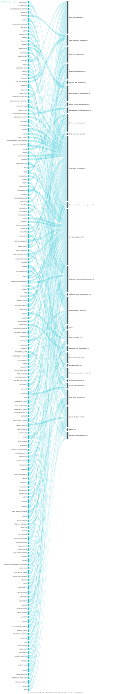

# Mapping v2 headings to ICLR catchwords (Level 1)

Crosswalk of the 28 headings of the [v2 candidate public-facing top-level taxonomy](candidate-public-top-level-taxonomy-v2.md) to the 177 top-level (Level-1, ALL-CAPS) [ICLR catchword headings](../notes/iclr-topic-taxonomy.md). This is ICLR's fine-grained subject-matter index — much closer to a full doctrinal vocabulary than its 14 Legal Topics (crosswalked separately: [mapping to ICLR Legal Topics](v2-iclr-mapping.md)). It is the largest scheme mapped so far and the first to reach **all 28 v2 headings**. See the [mapping overview](v2-heading-scheme-mapping.md) for method and other schemes.

## Crosswalk

The mapping is many-to-many; **bold** = primary target, secondary links reflect the v2 multi-label model. Court-name catchwords (COUNTY COURT, SUPREME COURT, etc.) are institution labels mapped to *Courts, police and legal help* — in the v2 design court, procedure and remedy belong to that heading as a facet dimension rather than a subject, and they are retained here for completeness.

| ICLR Level-1 catchword            | Maps to v2 headings                                                                      |
| --------------------------------- | ---------------------------------------------------------------------------------------- |
| ACCOUNTANT                        | **Business, trade and industry (16)**                                                    |
| ADJUDICATION                      | **Courts, police and legal help (11)**                                                   |
| ADMINISTRATION OF ESTATES         | **Later life, death and wills (26)**                                                     |
| ADMIRALTY                         | **Travel and transport (18)**                                                            |
| ADOPTION                          | **Family, children and relationships (2)**                                               |
| AGENCY                            | **Business, trade and industry (16)**; Your rights and the state (13)                    |
| AGRICULTURAL HOLDING              | **Farming, animals and the countryside (22)**                                            |
| AIRCRAFT                          | **Travel and transport (18)**                                                            |
| ANIMAL                            | **Farming, animals and the countryside (22)**                                            |
| ARBITRATION                       | **Courts, police and legal help (11)**                                                   |
| AUDITOR                           | **Business, trade and industry (16)**                                                    |
| BAILMENT                          | **Your rights and the state (13)**                                                       |
| BANKING                           | **Money, banking and financial services (6)**                                            |
| BANKRUPTCY                        | **Money, banking and financial services (6)**; Business, trade and industry (16)         |
| BARRISTER                         | **Courts, police and legal help (11)**                                                   |
| BROADCASTING                      | **Culture, media and sport (24)**                                                        |
| BUILDING                          | **Business, trade and industry (16)**; Home, housing and land (1)                        |
| BURIAL                            | **Later life, death and wills (26)**                                                     |
| CARRIAGE BY LAND                  | **Travel and transport (18)**                                                            |
| CHARITY                           | **Government, Parliament and the constitution (14)**                                     |
| CHATTEL                           | **Your rights and the state (13)**                                                       |
| CHILDREN                          | **Family, children and relationships (2)**                                               |
| CIVIL PARTNERSHIP                 | **Family, children and relationships (2)**                                               |
| COMMONS                           | **Farming, animals and the countryside (22)**; Environment and nature (20)               |
| COMPANY                           | **Business, trade and industry (16)**                                                    |
| COMPETITION                       | **Business, trade and industry (16)**                                                    |
| COMPULSORY PURCHASE               | **Home, housing and land (1)**                                                           |
| CONFIDENTIAL INFORMATION          | **Your rights and the state (13)**; Digital life and technology (25)                     |
| CONFLICT OF LAWS                  | **International affairs and treaties (28)**; Courts, police and legal help (11)          |
| CONSTITUTION                      | **Government, Parliament and the constitution (14)**                                     |
| CONSUMER PROTECTION               | **Buying and selling, consumer protection (8)**                                          |
| CONTEMPT OF COURT                 | **Courts, police and legal help (11)**                                                   |
| CONTRACT                          | **Your rights and the state (13)**; Business, trade and industry (16)                    |
| COPYRIGHT                         | **Digital life and technology (25)**                                                     |
| CORONER                           | **Courts, police and legal help (11)**; Later life, death and wills (26)                 |
| COSTS                             | **Courts, police and legal help (11)**                                                   |
| COUNTY COURT                      | **Courts, police and legal help (11)**                                                   |
| COURT OF APPEAL (CIVIL DIVISION)  | **Courts, police and legal help (11)**                                                   |
| COURT OF PROTECTION               | **Later life, death and wills (26)**; Courts, police and legal help (11)                 |
| CRIME                             | **Crime and criminal offences (9)**                                                      |
| CROWN                             | **Government, Parliament and the constitution (14)**                                     |
| CROWN COURT                       | **Courts, police and legal help (11)**                                                   |
| DAMAGES                           | **Courts, police and legal help (11)**                                                   |
| DATA PROTECTION                   | **Digital life and technology (25)**; Your rights and the state (13)                     |
| DEBT                              | **Money, banking and financial services (6)**                                            |
| DEED                              | **Home, housing and land (1)**; Your rights and the state (13)                           |
| DEFAMATION                        | **Your rights and the state (13)**                                                       |
| DENTIST                           | **Health, care and wellbeing (3)**                                                       |
| DESIGN                            | **Digital life and technology (25)**                                                     |
| DEVOLUTION                        | **Government, Parliament and the constitution (14)**                                     |
| DISCRIMINATION                    | **Your rights and the state (13)**; Work, jobs and the workplace (4)                     |
| EASEMENT                          | **Home, housing and land (1)**                                                           |
| ECCLESIASTICAL LAW                | **Religion (27)**                                                                        |
| EDUCATION                         | **Education, skills and children (5)**                                                   |
| ELECTION                          | **Government, Parliament and the constitution (14)**                                     |
| ELECTRICITY                       | **Energy and net zero (21)**                                                             |
| EMPLOYMENT                        | **Work, jobs and the workplace (4)**                                                     |
| ENVIRONMENT                       | **Environment and nature (20)**                                                          |
| EQUITY                            | **Your rights and the state (13)**                                                       |
| ESTOPPEL                          | **Your rights and the state (13)**                                                       |
| EUROPEAN UNION                    | **International affairs and treaties (28)**                                              |
| EVIDENCE                          | **Courts, police and legal help (11)**                                                   |
| EXECUTION                         | **Courts, police and legal help (11)**                                                   |
| EXTRADITION                       | **Immigration, visas and citizenship (19)**; Crime and criminal offences (9)             |
| FALSE IMPRISONMENT                | **Your rights and the state (13)**; Crime and criminal offences (9)                      |
| FAMILY COURT                      | **Family, children and relationships (2)**; Courts, police and legal help (11)           |
| FAMILY PROVISION                  | **Later life, death and wills (26)**                                                     |
| FATAL ACCIDENTS ACTS              | **Your rights and the state (13)**; Travel and transport (18)                            |
| FINANCIAL SERVICES                | **Money, banking and financial services (6)**                                            |
| FIREARMS                          | **Crime and criminal offences (9)**                                                      |
| FISHERY                           | **Farming, animals and the countryside (22)**; Environment and nature (20)               |
| FOOD AND DRUGS                    | **Food and food standards (23)**; Health, care and wellbeing (3)                         |
| FRAUD                             | **Crime and criminal offences (9)**; Your rights and the state (13)                      |
| FREEDOM OF INFORMATION            | **Your rights and the state (13)**; Government, Parliament and the constitution (14)     |
| GAMING                            | **Culture, media and sport (24)**                                                        |
| GENDER                            | **Your rights and the state (13)**                                                       |
| GIFT                              | **Later life, death and wills (26)**                                                     |
| GUARANTEE                         | **Your rights and the state (13)**                                                       |
| HABEAS CORPUS                     | **Courts, police and legal help (11)**; Crime and criminal offences (9)                  |
| HEALTH AND SAFETY                 | **Public and personal safety (10)**; Work, jobs and the workplace (4)                    |
| HIGH COURT                        | **Courts, police and legal help (11)**                                                   |
| HIGHWAY                           | **Travel and transport (18)**; Home, housing and land (1)                                |
| HOUSING                           | **Home, housing and land (1)**                                                           |
| HUMAN RIGHTS                      | **Your rights and the state (13)**                                                       |
| IMMIGRATION                       | **Immigration, visas and citizenship (19)**                                              |
| INDUSTRIAL RELATIONS              | **Work, jobs and the workplace (4)**                                                     |
| INDUSTRIAL TRAINING               | **Work, jobs and the workplace (4)**; Education, skills and children (5)                 |
| INJUNCTION                        | **Courts, police and legal help (11)**                                                   |
| INSOLVENCY                        | **Business, trade and industry (16)**; Money, banking and financial services (6)         |
| INSURANCE                         | **Money, banking and financial services (6)**                                            |
| INTEREST                          | **Money, banking and financial services (6)**                                            |
| INTERNATIONAL LAW                 | **International affairs and treaties (28)**                                              |
| INVESTIGATORY POWERS              | **Courts, police and legal help (11)**; Your rights and the state (13)                   |
| JOINT INTEREST                    | **Home, housing and land (1)**                                                           |
| JUDGE                             | **Courts, police and legal help (11)**                                                   |
| JUDGMENT                          | **Courts, police and legal help (11)**                                                   |
| JUDICIAL PRECEDENT                | **Courts, police and legal help (11)**                                                   |
| JUDICIAL REVIEW                   | **Government, Parliament and the constitution (14)**                                     |
| LAND REGISTRATION                 | **Home, housing and land (1)**                                                           |
| LANDLORD AND TENANT               | **Home, housing and land (1)**                                                           |
| LAW REFORM                        | **Government, Parliament and the constitution (14)**; Courts, police and legal help (11) |
| LEGAL AID                         | **Courts, police and legal help (11)**                                                   |
| LICENSING                         | **Business, trade and industry (16)**; Culture, media and sport (24)                     |
| LIEN                              | **Your rights and the state (13)**                                                       |
| LIMITATION OF ACTION              | **Courts, police and legal help (11)**; Your rights and the state (13)                   |
| LOCAL GOVERNMENT                  | **Government, Parliament and the constitution (14)**                                     |
| MAGISTRATES' COURT                | **Courts, police and legal help (11)**                                                   |
| MAINTENANCE OF SUIT               | **Courts, police and legal help (11)**                                                   |
| MARRIAGE                          | **Family, children and relationships (2)**                                               |
| MEDICAL PRACTITIONER              | **Health, care and wellbeing (3)**; Business, trade and industry (16)                    |
| MENTAL CAPACITY                   | **Later life, death and wills (26)**; Health, care and wellbeing (3)                     |
| MENTAL HEALTH                     | **Health, care and wellbeing (3)**                                                       |
| MILITARY LAW                      | **National security, defence and emergencies (12)**                                      |
| MINES                             | **Environment and nature (20)**; Farming, animals and the countryside (22)               |
| MOBILE HOMES                      | **Home, housing and land (1)**                                                           |
| MORTGAGE                          | **Money, banking and financial services (6)**; Home, housing and land (1)                |
| NATIONAL HEALTH SERVICE           | **Health, care and wellbeing (3)**                                                       |
| NATIONAL SECURITY                 | **National security, defence and emergencies (12)**                                      |
| NATIONALITY                       | **Immigration, visas and citizenship (19)**                                              |
| NATURAL JUSTICE                   | **Courts, police and legal help (11)**; Government, Parliament and the constitution (14) |
| NEGLIGENCE                        | **Your rights and the state (13)**                                                       |
| NUISANCE                          | **Your rights and the state (13)**; Home, housing and land (1)                           |
| OCCUPIERS' LIABILITY              | **Your rights and the state (13)**; Home, housing and land (1)                           |
| OPTION                            | **Your rights and the state (13)**                                                       |
| OSTEOPATH                         | **Health, care and wellbeing (3)**; Business, trade and industry (16)                    |
| PARLIAMENT                        | **Government, Parliament and the constitution (14)**                                     |
| PARTNERSHIP                       | **Business, trade and industry (16)**                                                    |
| PASSING OFF                       | **Digital life and technology (25)**                                                     |
| PATENT                            | **Digital life and technology (25)**                                                     |
| PENSIONS                          | **Benefits, pensions and public support (7)**; Money, banking and financial services (6) |
| PLANNING                          | **Home, housing and land (1)**; Government, Parliament and the constitution (14)         |
| PLANT BREEDERS' RIGHTS            | **Digital life and technology (25)**; Farming, animals and the countryside (22)          |
| POLICE                            | **Courts, police and legal help (11)**; Crime and criminal offences (9)                  |
| POLITICAL PARTY                   | **Government, Parliament and the constitution (14)**                                     |
| POWER OF ATTORNEY                 | **Later life, death and wills (26)**                                                     |
| PRACTICE                          | **Courts, police and legal help (11)**                                                   |
| PRISONS                           | **Courts, police and legal help (11)**                                                   |
| PRIVY COUNCIL                     | **Courts, police and legal help (11)**                                                   |
| PROCEEDS OF CRIME                 | **Crime and criminal offences (9)**; Courts, police and legal help (11)                  |
| PROFIT A PRENDRE                  | **Home, housing and land (1)**                                                           |
| PUBLIC HEALTH                     | **Health, care and wellbeing (3)**                                                       |
| PUBLIC POLICY                     | **Your rights and the state (13)**                                                       |
| PUBLIC PROCUREMENT                | **Government finance and procurement (15)**                                              |
| RAILWAYS                          | **Travel and transport (18)**                                                            |
| RATING                            | **Home, housing and land (1)**; Tax (17)                                                 |
| REGISTRATION OF BIRTHS AND DEATHS | **Later life, death and wills (26)**                                                     |
| RESTITUTION                       | **Your rights and the state (13)**                                                       |
| RESTRAINT OF TRADE                | **Work, jobs and the workplace (4)**; Business, trade and industry (16)                  |
| RESTRICTIVE COVENANT              | **Home, housing and land (1)**                                                           |
| REVENUE                           | **Tax (17)**                                                                             |
| RIVER                             | **Environment and nature (20)**                                                          |
| ROAD TRAFFIC                      | **Travel and transport (18)**; Crime and criminal offences (9)                           |
| SALE OF GOODS                     | **Buying and selling, consumer protection (8)**; Business, trade and industry (16)       |
| SANCTIONS                         | **International affairs and treaties (28)**                                              |
| SETTLEMENT                        | **Later life, death and wills (26)**; Your rights and the state (13)                     |
| SHIPPING                          | **Travel and transport (18)**                                                            |
| SOCIAL SECURITY                   | **Benefits, pensions and public support (7)**                                            |
| SOCIAL WORKER                     | **Health, care and wellbeing (3)**; Family, children and relationships (2)               |
| SOLICITOR                         | **Courts, police and legal help (11)**                                                   |
| STATUTE                           | **Courts, police and legal help (11)**; Government, Parliament and the constitution (14) |
| STATUTORY INSTRUMENT              | **Government, Parliament and the constitution (14)**; Courts, police and legal help (11) |
| SUPREME COURT                     | **Courts, police and legal help (11)**                                                   |
| TELECOMMUNICATIONS                | **Digital life and technology (25)**                                                     |
| TERRORISM                         | **Crime and criminal offences (9)**; National security, defence and emergencies (12)     |
| TORT                              | **Your rights and the state (13)**                                                       |
| TRADE DISPUTE                     | **Work, jobs and the workplace (4)**                                                     |
| TRADE MARK                        | **Digital life and technology (25)**                                                     |
| TRADE UNION                       | **Work, jobs and the workplace (4)**                                                     |
| TRADING STANDARDS                 | **Buying and selling, consumer protection (8)**; Business, trade and industry (16)       |
| TRIBUNAL                          | **Courts, police and legal help (11)**                                                   |
| TRUST OF LAND                     | **Home, housing and land (1)**; Your rights and the state (13)                           |
| TRUSTS                            | **Your rights and the state (13)**; Later life, death and wills (26)                     |
| UNDUE INFLUENCE                   | **Your rights and the state (13)**                                                       |
| VENDOR AND PURCHASER              | **Home, housing and land (1)**                                                           |
| VICARIOUS LIABILITY               | **Your rights and the state (13)**; Work, jobs and the workplace (4)                     |
| WATER                             | **Environment and nature (20)**                                                          |
| WILL                              | **Later life, death and wills (26)**                                                     |
The numbers in right hand column indicate the index (#) of the term in [the v2 candidate](candidate-public-top-level-taxonomy-v2) table. Where the catchword maps to more than one term on the candidate the primary term is shown in bold.
## Sankey

177 source headings, 232 links, 28 of 28 v2 headings reached.

## Findings

- **First scheme to reach every v2 heading.** The catchword vocabulary feeds even the two headings no case-law scheme recognised before: *HEALTH AND SAFETY* → *Public and personal safety (10)* and *FOOD AND DRUGS* → *Food and food standards (23)*. This resolves (in principle) the concern that those two legislation-biased headings had no case-law counterpart — though both still rest on a single catchword each, so real-volume validation remains worthwhile.
- **Institution and remedy catchwords confirm the facet design.** Around 30 headings are court names (COUNTY COURT, PRIVY COUNCIL…), judges, procedure (EVIDENCE, PRACTICE, LIMITATION OF ACTION) or remedies (DAMAGES, INJUNCTION, EXECUTION). All route to *Courts, police and legal help (11)* — but the v2 design treats court/procedure/remedy as separate facets, and these catchwords are the strongest demonstration of why: they are orthogonal to subject, which is exactly how ICLR uses them (parallel subject-matter groups per case).
- **Doctrinal headings fan into *Your rights and the state (13)** more than any other: CONTRACT, TORT, EQUITY, TRUSTS, DEFAMATION, NEGLIGENCE, RESTITUTION, UNDUE INFLUENCE, PUBLIC POLICY, ESTOPPEL, BAILMENT, LIEN… — confirming 13 as the doctrinal workhorse, echoing the [curricula mapping](v2-legal-subject-areas-mapping.md).
- **Professional-discipline headings** (ACCOUNTANT, AUDITOR, DENTIST, MEDICAL PRACTITIONER, OSTEOPATH, SOLICITOR, BARRISTER, SOCIAL WORKER) split between the regulated domain (3/11) and *Business, trade and industry (16)* — professional regulation is a cross-cutting theme like procedure, and the split mappings record that honestly.
- **Where the mapping is genuinely ambiguous:** BANKRUPTCY and INSOLVENCY split personal/corporate (6/16), MORTGAGE sits in money (6) but its possession disputes are land (1), PLANNING is land-led but local-government-challenged (1/14), and POLICE is institution-led (11) but police-conduct cases shade into rights (13/9). All four are the same boundary tensions identified in the [legislation thesaurus comparison](legislation-thesaurus-comparison.md) — evidence that v2's polyhierarchy is the right resolution.
- **Comparison with the ICLR Legal Topics mapping:** the 14-topic crosswalk reached 18 headings; the 177 catchwords reach 28. The catchword layer is the better analogue of the v2 taxonomy's *lower* levels, while the Legal Topics parallel its top level — a live demonstration of the v2 two-layer design (public headings ← doctrinal/catchword terms underneath).

## Related pages

- [Mapping overview](v2-heading-scheme-mapping.md)
- [Candidate public-facing top-level taxonomy (v2)](candidate-public-top-level-taxonomy-v2.md)
- [ICLR topics and catchwords](../notes/iclr-topic-taxonomy.md)
