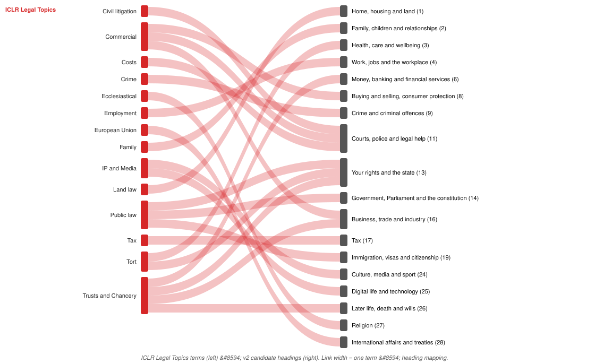

# Mapping v2 headings to ICLR Legal Topics

Crosswalk of the 28 headings of the [v2 candidate public-facing top-level taxonomy](candidate-public-top-level-taxonomy-v2.md) to the 14 [ICLR Legal Topics](../notes/iclr-topic-taxonomy.md). See the [mapping overview](v2-heading-scheme-mapping.md) for method and other schemes.

## Crosswalk

The mapping is many-to-many; **bold** = primary target, secondary links reflect the v2 multi-label model.

| ICLR topic | Maps to v2 headings (bold = primary) |
|---|---|
| Civil litigation | **Courts, police and legal help (11)** |
| Commercial | **Business, trade and industry (16)**; Buying and selling, consumer protection (8) (consumer protection); Courts, police and legal help (11) (arbitration, conflict of laws) |
| Costs | **Courts, police and legal help (11)** |
| Crime | **Crime and criminal offences (9)** |
| Ecclesiastical | **Religion (27)** |
| Employment | **Work, jobs and the workplace (4)** |
| European Union | **International affairs and treaties (28)** |
| Family | **Family, children and relationships (2)** |
| IP and Media | **Culture, media and sport (24)** and **Digital life and technology (25)** (co-primary; patents/copyright → 25, media/broadcasting → 24) |
| Land law | **Home, housing and land (1)** |
| Public law | **Government, Parliament and the constitution (14)**; Your rights and the state (13) (FOI, data protection); Immigration, visas and citizenship (19) |
| Tax | **Tax (17)** |
| Tort | **Your rights and the state (13)** (negligence, defamation); Health, care and wellbeing (3) (clinical negligence) |
| Trusts and Chancery | **Your rights and the state (13)** (trusts, equity); Money, banking and financial services (6) (insolvency); Business, trade and industry (16) (partnership); Later life, death and wills (26) |

## Sankey

14 source topics, 23 links, 18 of 28 v2 headings reached.

## Findings

- **ICLR is the only scheme that feeds *Religion (27)*** (Ecclesiastical) — support for the user's decision to keep that heading.
- *Tort*, *Trusts and Chancery* and *Public law* each split across 2–4 v2 headings — the many-to-many model working as designed, and where ICLR's singular-topic assignment would force arbitrary choices that v2's multi-labelling avoids.
- Conversely, *Commercial*, *Public law* and *Land law* each absorb content the v2 list keeps separate (consumer protection, police, planning).
- *IP and Media* is the one ICLR topic whose v2 target is genuinely co-primary (24 + 25): the v2 split of media/broadcasting from technology mirrors the legislation thesaurus's *Culture, Media and Sport* vs *Technology, Data and Communication*.

## Related pages

- [Mapping overview](v2-heading-scheme-mapping.md)
- [Candidate public-facing top-level taxonomy (v2)](candidate-public-top-level-taxonomy-v2.md)
- [ICLR topics and catchwords](../notes/iclr-topic-taxonomy.md)
