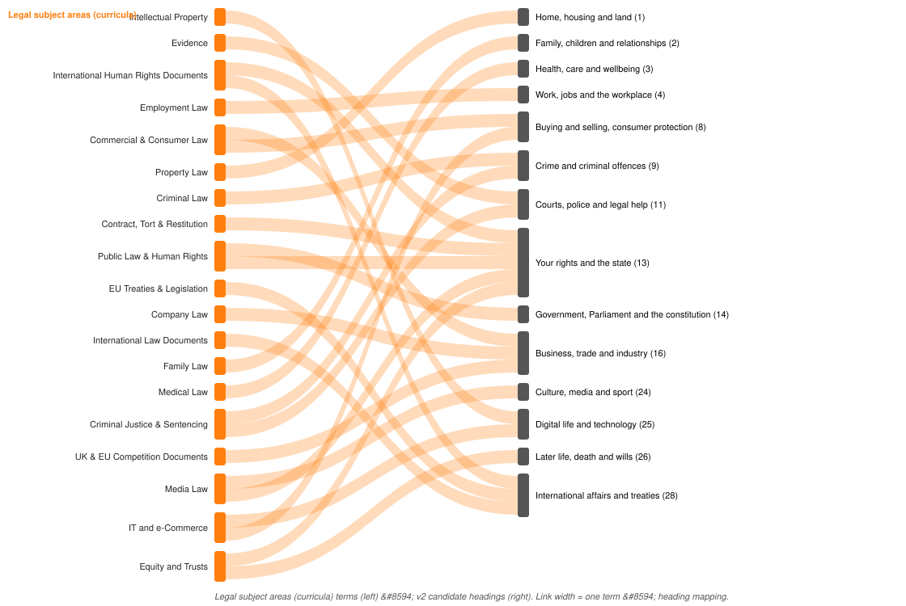

# Mapping v2 headings to Legal subject areas (curricula)

Crosswalk of the 28 headings of the [v2 candidate public-facing top-level taxonomy](candidate-public-top-level-taxonomy-v2.md) to the 18 [Legal subject areas](../taxonomy-extractions/Legal%20subject%20areas.md) derived from law curricula (Blackstone's Statutes and the BSB Bar Qualification Manual). This scheme is doctrinal — a law-school map rather than a case-law classification — so it provides a different kind of check on the v2 headings: whether the problem-led wording can still be located by someone thinking in curriculum terms. See the [mapping overview](v2-heading-scheme-mapping.md) for method and other schemes.

## Crosswalk

The mapping is many-to-many; **bold** = primary target, secondary links reflect the v2 multi-label model.

| Legal subject area | Maps to v2 headings (bold = primary) |
|---|---|
| Intellectual Property | **Digital life and technology (25)** |
| Evidence | **Courts, police and legal help (11)** |
| International Human Rights Documents | **Your rights and the state (13)**; International affairs and treaties (28) (treaty instruments such as the ECHR) |
| Employment Law | **Work, jobs and the workplace (4)** |
| Commercial & Consumer Law | **Business, trade and industry (16)**; Buying and selling, consumer protection (8) |
| Property Law | **Home, housing and land (1)** |
| Criminal Law | **Crime and criminal offences (9)** |
| Contract, Tort & Restitution | **Your rights and the state (13)** |
| Public Law & Human Rights | **Government, Parliament and the constitution (14)**; Your rights and the state (13) |
| EU Treaties & Legislation | **International affairs and treaties (28)** |
| Company Law | **Business, trade and industry (16)** |
| International Law Documents | **International affairs and treaties (28)** |
| Family Law | **Family, children and relationships (2)** |
| Medical Law | **Health, care and wellbeing (3)** |
| Criminal Justice & Sentencing | **Crime and criminal offences (9)**; Courts, police and legal help (11) (sentencing, criminal procedure) |
| UK & EU Competition Documents | **Business, trade and industry (16)** |
| Media Law | **Culture, media and sport (24)**; Your rights and the state (13) (defamation) |
| IT and e-Commerce | **Digital life and technology (25)**; Buying and selling, consumer protection (8) (online/distance selling) |
| Equity and Trusts | **Your rights and the state (13)**; Later life, death and wills (26) |

## Sankey

19 source areas, 26 links, 14 of 28 v2 headings reached.

## Findings

- **A doctrinal scheme maps cleanly but thinly.** Every curriculum area maps to at least one v2 heading, but only 14 of the 28 headings are reached — the narrowest scheme so far (ICLR reaches 18, Sargeant 25). The unreached 14 are the problem-led/public-service headings the curriculum does not recognise as subjects: *Benefits*, *Education*, *Immigration*, *Money/banking*, *Travel*, *Environment*, *Energy*, *Farming*, *Food*, *Public and personal safety*, *National security*, *Government finance and procurement*, *Religion*, and *Business*'s insolvency side is only implicit. This is the expected doctrinal blind spot, and it inverts the v1 finding about advice-sector schemes: those miss criminal/commercial/tax; the curriculum misses the administrative and life-problem areas.
- **Your rights and the state (13) is the workhorse.** Four curriculum areas (Contract/Tort/Restitution, Public Law's rights component, Media Law's defamation, Equity and Trusts, plus International Human Rights) route to it — evidence that the heading is doing the job it was designed for as the doctrinal catch-all alongside *Civil Law*.
- **The "Documents" suffix areas are sources, not subjects.** *International Human Rights Documents*, *EU Treaties & Legislation*, *International Law Documents* and *UK & EU Competition Documents* are reading lists of instruments rather than subject areas; they map to v2 headings via the substantive law they contain. This mirrors the matter-type vs subject distinction seen in UKSC's *Veterinary surgeons*.
- **Criminal Justice & Sentencing splits 9/11** the same way Sargeant does (Crime vs Prison law) — consistent triangulation.
- For a non-lawyer audience this scheme is the cautionary case: a curriculum-derived top level would be near-useless for public browsing, which is the core justification for the problem-led v2 wording with doctrine mapped underneath rather than surfaced.

## Related pages

- [Mapping overview](v2-heading-scheme-mapping.md)
- [Candidate public-facing top-level taxonomy (v2)](candidate-public-top-level-taxonomy-v2.md)
- [Legal subject areas (curricula)](../taxonomy-extractions/Legal%20subject%20areas.md)
