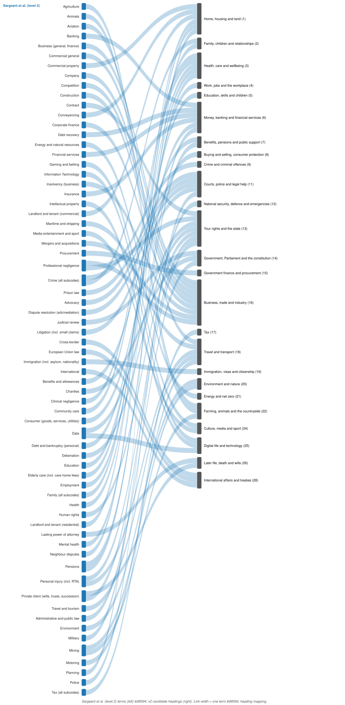

# Mapping v2 headings to Sargeant et al. (second level)

Crosswalk of the 28 headings of the [v2 candidate public-facing top-level taxonomy](candidate-public-top-level-taxonomy-v2.md) to the second-level areas of the [Sargeant et al. classification](../taxonomy-extractions/Sargeant%202026%20case%20law%20classification.md). Sargeant's 6-area top level is too coarse to be informative ("Personal and consumer matters" alone scatters across 12 v2 headings), so the mapping is done at second level (67 areas, collapsing per-area subcodes such as legal-aid variants). See the [mapping overview](v2-heading-scheme-mapping.md) for method and other schemes.

## Crosswalk

The mapping is many-to-many; **bold** = primary target, secondary links reflect the v2 multi-label model.

| Sargeant second-level area | Maps to v2 headings (bold = primary) |
|---|---|
| Agriculture | **Farming, animals and the countryside (22)** |
| Animals | **Farming, animals and the countryside (22)** |
| Aviation | **Travel and transport (18)** |
| Banking | **Money, banking and financial services (6)** |
| Business (general, finance) | **Business, trade and industry (16)** |
| Commercial — general | **Business, trade and industry (16)** |
| Commercial — property | **Home, housing and land (1)** |
| Company | **Business, trade and industry (16)** |
| Competition | **Business, trade and industry (16)** |
| Construction | **Business, trade and industry (16)** |
| Contract | **Your rights and the state (13)** |
| Conveyancing | **Home, housing and land (1)** |
| Corporate finance | **Business, trade and industry (16)** |
| Debt recovery | **Money, banking and financial services (6)** |
| Energy and natural resources | **Energy and net zero (21)** |
| Financial services | **Money, banking and financial services (6)** |
| Gaming and betting | **Culture, media and sport (24)** |
| Information Technology | **Digital life and technology (25)** |
| Insolvency and restructuring (business) | **Business, trade and industry (16)** |
| Insurance | **Money, banking and financial services (6)** |
| Intellectual property | **Digital life and technology (25)** |
| Landlord and tenant (commercial) | **Home, housing and land (1)** |
| Maritime and shipping | **Travel and transport (18)** |
| Media entertainment and sport | **Culture, media and sport (24)** |
| Mergers and acquisitions | **Business, trade and industry (16)** |
| Procurement | **Government finance and procurement (15)** |
| Professional negligence | **Business, trade and industry (16)**; Your rights and the state (13) |
| Crime (all subcodes) | **Crime and criminal offences (9)**; Family, children and relationships (2) (domestic violence) |
| Prison law | **Courts, police and legal help (11)** |
| Advocacy | **Courts, police and legal help (11)** |
| Dispute resolution (arbitration, mediation) | **Courts, police and legal help (11)** |
| Judicial review | **Government, Parliament and the constitution (14)** |
| Litigation (incl. small claims) | **Courts, police and legal help (11)** |
| Cross-border | **International affairs and treaties (28)** |
| European Union law | **International affairs and treaties (28)** |
| Immigration (incl. asylum, nationality) | **Immigration, visas and citizenship (19)** |
| International | **International affairs and treaties (28)** |
| Benefits and allowances | **Benefits, pensions and public support (7)** |
| Charities | **Government, Parliament and the constitution (14)** |
| Clinical negligence | **Health, care and wellbeing (3)** |
| Community care | **Health, care and wellbeing (3)** |
| Consumer (goods, services, utilities) | **Buying and selling, consumer protection (8)** |
| Data | **Your rights and the state (13)**; Digital life and technology (25) |
| Debt and bankruptcy (personal) | **Money, banking and financial services (6)** |
| Defamation | **Your rights and the state (13)** |
| Education | **Education, skills and children (5)** |
| Elderly care (incl. care home fees) | **Health, care and wellbeing (3)** |
| Employment | **Work, jobs and the workplace (4)** |
| Family (all subcodes) | **Family, children and relationships (2)** |
| Health | **Health, care and wellbeing (3)** |
| Human rights | **Your rights and the state (13)** |
| Landlord and tenant (general, leasehold valuation, residential) | **Home, housing and land (1)** |
| Lasting power of attorney | **Later life, death and wills (26)** |
| Mental health | **Health, care and wellbeing (3)** |
| Neighbour disputes | **Home, housing and land (1)** |
| Pensions | **Benefits, pensions and public support (7)**; Money, banking and financial services (6) |
| Personal injury (incl. road traffic) | **Your rights and the state (13)**; Travel and transport (18) (RTA) |
| Private client (wills, trusts, succession) | **Later life, death and wills (26)**; Your rights and the state (13) (trusts) |
| Travel and tourism | **Travel and transport (18)** |
| Administrative and public law | **Government, Parliament and the constitution (14)** |
| Environment | **Environment and nature (20)** |
| Military | **National security, defence and emergencies (12)** |
| Mining | **Environment and nature (20)**; Farming, animals and the countryside (22) |
| Motoring | **Travel and transport (18)** |
| Planning | **Home, housing and land (1)** |
| Police | **Courts, police and legal help (11)** |
| Tax (all subcodes) | **Tax (17)** |

## Sankey

67 source terms, 74 links, 25 of 28 v2 headings reached.

## Findings

- **Level 2 confirms the v2 structure.** At top level, "Personal and consumer matters" is a residual bucket; at second level only four areas need genuine multi-primary treatment (*Data*, *Pensions*, *Personal injury*, *Private client*), and each splits along exactly the lines the [legislation comparison](legislation-thesaurus-comparison.md) predicted (e.g. pensions → state benefits vs financial services).
- Sargeant is the only scheme feeding *Government finance and procurement (15)* (Procurement) and *National security, defence and emergencies (12)* (Military).
- Three v2 headings are not reached by any Sargeant level-2 area: *Public and personal safety (10)*, *Food and food standards (23)*, and *Religion (27)* — the first two are legislation-biased additions with no case-law-scheme counterpart.

## Related pages

- [Mapping overview](v2-heading-scheme-mapping.md)
- [Candidate public-facing top-level taxonomy (v2)](candidate-public-top-level-taxonomy-v2.md)
- [Sargeant et al. extraction](../taxonomy-extractions/Sargeant%202026%20case%20law%20classification.md)
