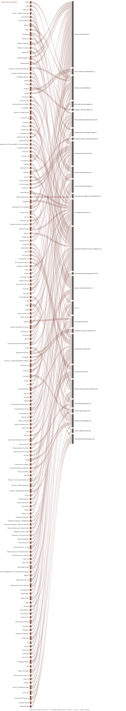

# Mapping v2 headings to smart survey search topics

Crosswalk of the 28 headings of the [v2 candidate public-facing top-level taxonomy](candidate-public-top-level-taxonomy-v2.md) to the 195 search-topic terms from the smart survey analysis (`docs/smart_survey_topics_analysis.csv`). Unlike the other mapped schemes, this is **real user vocabulary** — raw, uncontrolled, sometimes noisy — so it is the closest available test of whether the v2 headings answer the words people actually use. See the [mapping overview](v2-heading-scheme-mapping.md) for method and other schemes.

## Method note

Because the terms are uncontrolled, the method differs from the other schemes in one respect: **terms too unclear to map, or whose mapping would be very tenuous, are excluded rather than forced** (21 terms — see the omitted list below). 172 topics are mapped; each maps to one or more v2 headings (**bold** = primary). Terminological variants of the same concept are kept separate as the survey recorded them (e.g. *Companies* / *Company Law*; *Environment* / *Environmental Law* / *Environmental Protection*), since the variants themselves are the evidence of lay wording.

## Crosswalk

| Smart survey topic                                        | Maps to v2 headings (bold = primary)                                                     |
| --------------------------------------------------------- | ---------------------------------------------------------------------------------------- |
| ADHD                                                      | **Health, care and wellbeing (3)**                                                       |
| AML                                                       | **Crime and criminal offences (9)**                                                      |
| Agriculture                                               | **Farming, animals and the countryside (22)**                                            |
| Animal - Scientific Procedures                            | **Farming, animals and the countryside (22)**                                            |
| Animal Health                                             | **Farming, animals and the countryside (22)**                                            |
| Army And Defense                                          | **National security, defence and emergencies (12)**                                      |
| Asbestos                                                  | **Your rights and the state (13)**; Public and personal safety (10)                      |
| Autism                                                    | **Health, care and wellbeing (3)**                                                       |
| Bankruptcy                                                | **Money, banking and financial services (6)**; Business, trade and industry (16)         |
| Benefit Law                                               | **Benefits, pensions and public support (7)**                                            |
| Biodiversity Net Gain                                     | **Environment and nature (20)**; Home, housing and land (1)                              |
| Bribery & Corruption                                      | **Crime and criminal offences (9)**                                                      |
| Building Acts                                             | **Business, trade and industry (16)**; Home, housing and land (1)                        |
| Building Regulations                                      | **Home, housing and land (1)**; Public and personal safety (10)                          |
| Building Safety                                           | **Public and personal safety (10)**; Home, housing and land (1)                          |
| Capacity For Persons With Dementia                        | **Health, care and wellbeing (3)**; Later life, death and wills (26)                     |
| Charging For Replacement Bins                             | **Government, Parliament and the constitution (14)**                                     |
| Charitable Institutions.                                  | **Government, Parliament and the constitution (14)**                                     |
| Charities                                                 | **Government, Parliament and the constitution (14)**                                     |
| Charity                                                   | **Government, Parliament and the constitution (14)**                                     |
| Childcare                                                 | **Education, skills and children (5)**; Family, children and relationships (2)           |
| Children                                                  | **Family, children and relationships (2)**                                               |
| Civil Aviation                                            | **Travel and transport (18)**                                                            |
| Civil Court Rules                                         | **Courts, police and legal help (11)**                                                   |
| Cleaning Pavement & Gutters                               | **Government, Parliament and the constitution (14)**                                     |
| Co-operatives                                             | **Government, Parliament and the constitution (14)**                                     |
| Commons & Village Greens                                  | **Farming, animals and the countryside (22)**; Environment and nature (20)               |
| Commons Law                                               | **Farming, animals and the countryside (22)**; Environment and nature (20)               |
| Companies                                                 | **Business, trade and industry (16)**                                                    |
| Company Law                                               | **Business, trade and industry (16)**                                                    |
| Compensation                                              | **Your rights and the state (13)**                                                       |
| Competition Law                                           | **Business, trade and industry (16)**                                                    |
| Compulsory Purchase                                       | **Home, housing and land (1)**                                                           |
| Constitutional Law                                        | **Government, Parliament and the constitution (14)**                                     |
| Constitutional Law Of Ireland Within The United Kingdom   | **Government, Parliament and the constitution (14)**                                     |
| Constitutional Matters                                    | **Government, Parliament and the constitution (14)**                                     |
| Construction                                              | **Business, trade and industry (16)**                                                    |
| Contract Law                                              | **Your rights and the state (13)**; Business, trade and industry (16)                    |
| Conveyancing                                              | **Home, housing and land (1)**                                                           |
| Copyright                                                 | **Digital life and technology (25)**                                                     |
| Corporation Tax                                           | **Tax (17)**                                                                             |
| Cosmetics                                                 | **Buying and selling, consumer protection (8)**; Food and food standards (23)            |
| Councils                                                  | **Government, Parliament and the constitution (14)**                                     |
| Criminal Attempts                                         | **Crime and criminal offences (9)**                                                      |
| Criminal Damage                                           | **Crime and criminal offences (9)**                                                      |
| Criminal Law                                              | **Crime and criminal offences (9)**                                                      |
| Data Protection                                           | **Digital life and technology (25)**; Your rights and the state (13)                     |
| Defence Requirements                                      | **National security, defence and emergencies (12)**                                      |
| Disabilities                                              | **Your rights and the state (13)**; Health, care and wellbeing (3)                       |
| Discharge From The Mortgage                               | **Home, housing and land (1)**; Money, banking and financial services (6)                |
| Disease Control                                           | **Health, care and wellbeing (3)**; Farming, animals and the countryside (22)            |
| EU Law                                                    | **International affairs and treaties (28)**                                              |
| Economic Crime                                            | **Crime and criminal offences (9)**                                                      |
| Elderly Care Private Consultations                        | **Health, care and wellbeing (3)**                                                       |
| Elderly Inclusivity                                       | **Health, care and wellbeing (3)**; Your rights and the state (13)                       |
| Elections                                                 | **Government, Parliament and the constitution (14)**                                     |
| Employment                                                | **Work, jobs and the workplace (4)**                                                     |
| Employment Law                                            | **Work, jobs and the workplace (4)**                                                     |
| Energy Law                                                | **Energy and net zero (21)**                                                             |
| Energy Meters                                             | **Energy and net zero (21)**                                                             |
| Energy                                                    | **Energy and net zero (21)**                                                             |
| Environment                                               | **Environment and nature (20)**                                                          |
| Environmental Law                                         | **Environment and nature (20)**                                                          |
| Environmental Protection                                  | **Environment and nature (20)**                                                          |
| Equality For All Rules                                    | **Your rights and the state (13)**                                                       |
| Eviction                                                  | **Home, housing and land (1)**                                                           |
| Families                                                  | **Family, children and relationships (2)**                                               |
| Financial Crime                                           | **Crime and criminal offences (9)**                                                      |
| Financial Services                                        | **Money, banking and financial services (6)**                                            |
| Financial Services Law                                    | **Money, banking and financial services (6)**                                            |
| Fire Safety                                               | **Public and personal safety (10)**; Home, housing and land (1)                          |
| Flat Lease                                                | **Home, housing and land (1)**                                                           |
| Food & Beverage                                           | **Food and food standards (23)**                                                         |
| Fraud                                                     | **Crime and criminal offences (9)**                                                      |
| GDPR                                                      | **Digital life and technology (25)**; Your rights and the state (13)                     |
| Health                                                    | **Health, care and wellbeing (3)**                                                       |
| Health & Safety Law                                       | **Public and personal safety (10)**                                                      |
| Health & Safety                                           | **Public and personal safety (10)**                                                      |
| Highways                                                  | **Travel and transport (18)**; Home, housing and land (1)                                |
| Holding Public Bodies To Account                          | **Government, Parliament and the constitution (14)**; Your rights and the state (13)     |
| Homelessness                                              | **Home, housing and land (1)**                                                           |
| House Sale                                                | **Home, housing and land (1)**                                                           |
| Housing                                                   | **Home, housing and land (1)**                                                           |
| Housing Association Housing Register.                     | **Home, housing and land (1)**; Government, Parliament and the constitution (14)         |
| IP Law                                                    | **Digital life and technology (25)**                                                     |
| Ideological Persecution.                                  | **Your rights and the state (13)**; Immigration, visas and citizenship (19)              |
| Immigration                                               | **Immigration, visas and citizenship (19)**                                              |
| Insolvency - Special Administration Regimes.              | **Business, trade and industry (16)**                                                    |
| Insolvency Law                                            | **Business, trade and industry (16)**; Money, banking and financial services (6)         |
| Insolvency                                                | **Business, trade and industry (16)**; Money, banking and financial services (6)         |
| Journalism                                                | **Culture, media and sport (24)**; Your rights and the state (13)                        |
| Judiciary                                                 | **Courts, police and legal help (11)**                                                   |
| L&T                                                       | **Home, housing and land (1)**                                                           |
| Land Contamination                                        | **Environment and nature (20)**; Home, housing and land (1)                              |
| Land Law                                                  | **Home, housing and land (1)**                                                           |
| Landlords                                                 | **Home, housing and land (1)**                                                           |
| Legal Aid                                                 | **Courts, police and legal help (11)**                                                   |
| Local Government Administration                           | **Government, Parliament and the constitution (14)**                                     |
| Local Government Finance                                  | **Government, Parliament and the constitution (14)**; Tax (17)                           |
| Local Government                                          | **Government, Parliament and the constitution (14)**                                     |
| Mental Health                                             | **Health, care and wellbeing (3)**                                                       |
| Money Laundering                                          | **Crime and criminal offences (9)**                                                      |
| Mostly Constitutional Law.                                | **Government, Parliament and the constitution (14)**                                     |
| Motor Traffic                                             | **Travel and transport (18)**                                                            |
| NHS                                                       | **Health, care and wellbeing (3)**                                                       |
| Net Zero                                                  | **Energy and net zero (21)**                                                             |
| Non-domestic Rating And Council Tax                       | **Tax (17)**; Home, housing and land (1)                                                 |
| Nutrition Products                                        | **Food and food standards (23)**                                                         |
| Offenses Against The Person                               | **Crime and criminal offences (9)**                                                      |
| Offshore & Onshore Energy                                 | **Energy and net zero (21)**                                                             |
| Oil & Gas                                                 | **Energy and net zero (21)**                                                             |
| PECR                                                      | **Digital life and technology (25)**; Your rights and the state (13)                     |
| Parliamentary Complaints                                  | **Government, Parliament and the constitution (14)**                                     |
| Personal Data Account Information                         | **Digital life and technology (25)**                                                     |
| Personal Insolvency                                       | **Money, banking and financial services (6)**                                            |
| Planning                                                  | **Home, housing and land (1)**                                                           |
| Planning - Environmental Assessment                       | **Home, housing and land (1)**; Environment and nature (20)                              |
| Planning - Habitats Regulations                           | **Home, housing and land (1)**; Environment and nature (20)                              |
| Planning - Listed Buildings/heritage                      | **Home, housing and land (1)**; Culture, media and sport (24)                            |
| Prisons                                                   | **Courts, police and legal help (11)**                                                   |
| Private Companies                                         | **Business, trade and industry (16)**                                                    |
| Private Rented Sector                                     | **Home, housing and land (1)**                                                           |
| Procurement                                               | **Government finance and procurement (15)**                                              |
| Property                                                  | **Home, housing and land (1)**                                                           |
| Property Law                                              | **Home, housing and land (1)**                                                           |
| Protected Landscapes -                                    | **Environment and nature (20)**                                                          |
| Protected Landscapes - AONBsAonbs                         | **Environment and nature (20)**                                                          |
| Protected Landscapes - National Landscapes                | **Environment and nature (20)**                                                          |
| Protected Landscapes - National Parks                     | **Environment and nature (20)**                                                          |
| Protection Of Human Health                                | **Health, care and wellbeing (3)**                                                       |
| Protection Of The Environment                             | **Environment and nature (20)**                                                          |
| Public Administration                                     | **Government, Parliament and the constitution (14)**                                     |
| Public Governance                                         | **Government, Parliament and the constitution (14)**                                     |
| Public Governance - Courts                                | **Courts, police and legal help (11)**; Government, Parliament and the constitution (14) |
| Public Governance - Ministerial Powers)                   | **Government, Parliament and the constitution (14)**                                     |
| Public Governance - Tribunals                             | **Courts, police and legal help (11)**                                                   |
| Public Law                                                | **Government, Parliament and the constitution (14)**                                     |
| Public Order                                              | **Crime and criminal offences (9)**                                                      |
| Public Rights Of Way                                      | **Home, housing and land (1)**; Farming, animals and the countryside (22)                |
| Qualifying For Registration On A Council Housing Register | **Home, housing and land (1)**                                                           |
| Railways                                                  | **Travel and transport (18)**                                                            |
| Rates And Council Tax                                     | **Tax (17)**; Home, housing and land (1)                                                 |
| Rating And Council Tax Valuation                          | **Home, housing and land (1)**; Tax (17)                                                 |
| Reemployment                                              | **Work, jobs and the workplace (4)**                                                     |
| Renters Rights                                            | **Home, housing and land (1)**                                                           |
| Rights Of Way                                             | **Home, housing and land (1)**; Farming, animals and the countryside (22)                |
| SMEs                                                      | **Business, trade and industry (16)**                                                    |
| Sanctions                                                 | **International affairs and treaties (28)**                                              |
| Sexual Offenses                                           | **Crime and criminal offences (9)**                                                      |
| Social Housing                                            | **Home, housing and land (1)**                                                           |
| Social Security                                           | **Benefits, pensions and public support (7)**                                            |
| Social Security Tribunals                                 | **Benefits, pensions and public support (7)**; Courts, police and legal help (11)        |
| Social Work                                               | **Health, care and wellbeing (3)**                                                       |
| Stablecoins                                               | **Money, banking and financial services (6)**                                            |
| Standing For Parliament                                   | **Government, Parliament and the constitution (14)**                                     |
| Sustainability                                            | **Environment and nature (20)**; Energy and net zero (21)                                |
| Tax                                                       | **Tax (17)**                                                                             |
| Taxation                                                  | **Tax (17)**                                                                             |
| Tenant Fees                                               | **Home, housing and land (1)**                                                           |
| The Broads                                                | **Environment and nature (20)**                                                          |
| The Internet                                              | **Digital life and technology (25)**                                                     |
| The Nagoya Protocol                                       | **International affairs and treaties (28)**; Farming, animals and the countryside (22)   |
| Theft                                                     | **Crime and criminal offences (9)**                                                      |
| Tobacco And Vapes                                         | **Health, care and wellbeing (3)**; Food and food standards (23)                         |
| Town And Country Planning                                 | **Home, housing and land (1)**                                                           |
| Trade Law                                                 | **Business, trade and industry (16)**                                                    |
| Transport                                                 | **Travel and transport (18)**                                                            |
| Treaty Of Fundamental Rights                              | **Your rights and the state (13)**; International affairs and treaties (28)              |
| Trust Funds                                               | **Your rights and the state (13)**; Later life, death and wills (26)                     |
| Use Of Genetic Resources                                  | **Farming, animals and the countryside (22)**; International affairs and treaties (28)   |
| Vehiclular Parking                                        | **Travel and transport (18)**                                                            |
| Welfare Benefits                                          | **Benefits, pensions and public support (7)**                                            |
## Omitted topics (21)

Excluded as too unclear to map or too tenuous to be useful — with the reason where one can be inferred:

- **Survey noise / non-answers:** *NA*, *Others*, *Prefer_not_to_say*, *Obscure_items*
- **Named individuals / current affairs:** *Nigel Fararge*
- **Meta-topics, not subjects of cases:** *Current Legislation*, *Budget News*, *Regulatory Monitoring*, *Interesting-things - Changes In Law And Implications*
- **History, not law:** *Electoral History*, *History Of The Law Of Money*, *Lexical Synchronic Evolution* (linguistic change)
- **Unidentifiable abbreviations / terms:** *ARAP*, *Gold Clauses*, *Convertibility*, *Lead*, *Scotland Titles*, *Social Standards (In Trade?)*
- **Regions / instruments without a v2 subject home:** *Ireland* (a jurisdiction facet, not a subject), *Scientific Research* (Science, Research and Innovation was [omitted from the v2 list](candidate-public-top-level-taxonomy-v2.md) as not arising in case law)
- *Honours And Awards* — honours system matters could route to *Government, Parliament and the constitution (14)*, but the term is too vague to map confidently.

## Sankey

172 source topics, 217 links, 27 of 28 v2 headings reached.

## Findings

- **Everyday vocabulary lands on the problem-led headings without forcing.** *Renters Rights*, *Eviction*, *House Sale*, *Welfare Benefits*, *Homelessness* all map to the headings a non-lawyer would pick — direct validation of the v2 wording strategy. Even the abbreviations that work (*AML*, *GDPR*, *PECR*, *L&T*, *IP Law*) route cleanly.
- **27 of 28 headings are reached; the exception is *Religion (27)*** — no surveyed user searched for anything religious, and its only counterparts anywhere are ICLR's Ecclesiastical topic and UKSC's Mission and Pastoral Measures. The two thinnest v2 headings (*Public and personal safety* — *Health & Safety* terms — and *Food and food standards* — *Food & Beverage*, *Nutrition Products*, *Cosmetics*, *Tobacco And Vapes*) are all fed by this survey, which supports keeping them despite their thin case-law-scheme coverage.
- **The survey is the heaviest single feeder of *Public and personal safety (10)* and *Government finance and procurement (15)*** (*Procurement*) — the legislation-biased headings now have user-demand evidence behind them, not just thesaurus alignment.
- **Variant spellings confirm the need for synonyms, not new headings.** *Charity / Charities / Charitable Institutions.*, *Companies / Company Law*, *Social Security / Welfare Benefits / Benefit Law*, *Property / Property Law / Land Law*, *Commons Law / Commons & Village Greens* — the v2 design's alias/search-term layer is exactly what absorbs this variety.
- **Boundary ambiguities echo the earlier schemes.** *Fire Safety* splits 10/1, *Planning* sub-topics split 1/20 or 1/24 (heritage), *Bankruptcy / Insolvency* split personal (6) / corporate (16), *Discharge From The Mortgage* 1/6 — the same four boundary tensions already identified in the [legislation thesaurus comparison](legislation-thesaurus-comparison.md) and the [ICLR catchword mapping](v2-iclr-catchwords-mapping.md).
- **Terms with no natural v2 home point at facet gaps, not heading gaps.** *Judiciary*, *Civil Court Rules*, *Social Security Tribunals*, *Legal Aid* route to *Courts, police and legal help (11)*, reinforcing that court/procedure/institution is a cross-cutting facet; *Constitutional Law Of Ireland Within The United Kingdom* and *Ireland* point at the jurisdiction facet. None of this demands new headings.
- **Caveat on counts:** the CSV `COUNT` column (search frequencies) is mostly empty and was not used; weighting the Sankey by frequency would be a better test once populated.

## Related pages

- [Mapping overview](v2-heading-scheme-mapping.md)
- [Candidate public-facing top-level taxonomy (v2)](candidate-public-top-level-taxonomy-v2.md)
- [Smart survey topics data](../../../docs/smart_survey_topics_analysis.csv)
