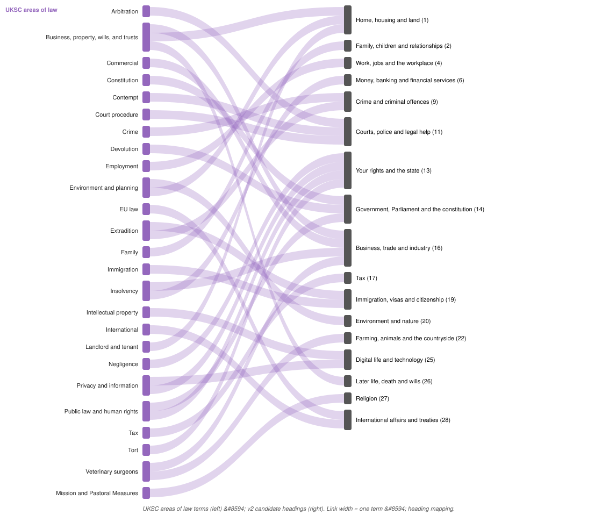

# Mapping v2 headings to UKSC areas of law

Crosswalk of the 28 headings of the [v2 candidate public-facing top-level taxonomy](candidate-public-top-level-taxonomy-v2.md) to the 25 [UKSC "Area of law" values](../taxonomy-extractions/uksc-area-of-law-taxonomy.md). See the [mapping overview](v2-heading-scheme-mapping.md) for method and other schemes.

## Crosswalk

The mapping is many-to-many; **bold** = primary target, secondary links reflect the v2 multi-label model.

| UKSC area | Maps to v2 headings (bold = primary) |
|---|---|
| Arbitration | **Courts, police and legal help (11)** |
| Business, property, wills, and trusts | **Business, trade and industry (16)**; Home, housing and land (1); Later life, death and wills (26) — a deliberately composite UKSC label that the v2 split resolves |
| Commercial | **Business, trade and industry (16)** |
| Constitution | **Government, Parliament and the constitution (14)** |
| Contempt | **Courts, police and legal help (11)** |
| Court procedure | **Courts, police and legal help (11)** |
| Crime | **Crime and criminal offences (9)** |
| Devolution | **Government, Parliament and the constitution (14)** |
| Employment | **Work, jobs and the workplace (4)** |
| Environment and planning | **Environment and nature (20)**; Home, housing and land (1) |
| EU law | **International affairs and treaties (28)** |
| Extradition | **Immigration, visas and citizenship (19)** (surrender/removal); Crime and criminal offences (9) |
| Family | **Family, children and relationships (2)** |
| Immigration | **Immigration, visas and citizenship (19)** |
| Insolvency | **Business, trade and industry (16)** (corporate); Money, banking and financial services (6) (personal) |
| Intellectual property | **Digital life and technology (25)** |
| International | **International affairs and treaties (28)** |
| Landlord and tenant | **Home, housing and land (1)** |
| Negligence | **Your rights and the state (13)** |
| Privacy and information | **Digital life and technology (25)**; Your rights and the state (13) |
| Public law and human rights | **Government, Parliament and the constitution (14)**; Your rights and the state (13) |
| Tax | **Tax (17)** |
| Tort | **Your rights and the state (13)** |
| Veterinary surgeons | **Business, trade and industry (16)** (professional regulation/discipline); Farming, animals and the countryside (22) |
| Mission and Pastoral Measures | **Religion (27)** |

## Sankey

25 source areas, 33 links, 17 of 28 v2 headings reached.

## Findings

- **Composite labels are the stress test.** *Business, property, wills, and trusts* spans three v2 headings (16, 1, 26), and *Environment and planning* spans two (20, 1) — the UKSC scheme keeps these merged where the v2 list splits along legislation-thesaurus lines.
- **Matter-type entries.** *Veterinary surgeons* (professional-discipline appeals) and *Mission and Pastoral Measures* (Church of England measures) are case-type/jurisdiction labels rather than subjects — the scheme mixes subject and matter-type facets, supporting the v2 design's decision to keep those dimensions separate. Both still have sensible subject homes (16/22 and 27).
- UKSC separates *Negligence* from *Tort* where ICLR folds both into *Tort* — v2 collapses both to *Your rights and the state (13)* without loss.
- *Extradition* is the most ambiguous cell (19 vs 9): surrender-to-foreign-state cases straddle immigration/border control and criminal procedure. Worth spot-checking against real cases.
- UKSC, like Sargeant, does not feed *Public and personal safety (10)* or *Food and food standards (23)*.

## Related pages

- [Mapping overview](v2-heading-scheme-mapping.md)
- [Candidate public-facing top-level taxonomy (v2)](candidate-public-top-level-taxonomy-v2.md)
- [UKSC area-of-law extraction](../taxonomy-extractions/uksc-area-of-law-taxonomy.md)
